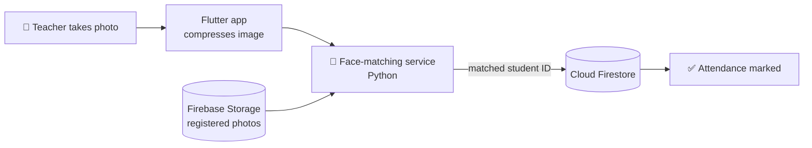

<div align="center">

# 🎓 FreeVid

### Take attendance with one photo.

A face-recognition attendance app built for an NGO that runs free classes for children.


</div>

---

## 💡 The problem

The NGO's volunteers took attendance on paper at every session. With many students and few volunteers, it took time away from teaching, and the records were easy to lose or get wrong.

## ✨ The solution

FreeVid turns attendance into a single tap. The teacher takes a photo of the student, the app recognises who it is, and attendance is saved instantly in the cloud. Admins can see who attended which session at any time.

## 🚀 Features

| | Feature | What it does |
|---|---|---|
| 📸 | **Face-based attendance** | Take or pick a photo; the app matches the face against registered students and marks them present |
| 👩‍🏫 | **Student and teacher registration** | Add people with their details and a reference photo |
| 📅 | **Event management** | Create sessions with a date, time range and custom fields; see upcoming and past events |
| 📊 | **Attendance records** | View attendance per student and per session |
| 🔐 | **Admin access** | Only registered admins can manage students, teachers and events |

## ⚙️ How it works



1. The teacher opens a session and takes a photo of the student.
2. The app compresses the photo and sends it, along with the registered students' photo URLs, to the face-matching service.
3. The service compares the faces and returns the best match.
4. The app updates that student's attendance in Firestore and shows a confirmation.

## 🛠️ Tech stack

| Layer | Technology |
|---|---|
| Mobile app | Flutter, Dart, Provider |
| Authentication | Firebase Authentication |
| Database | Cloud Firestore |
| Photo storage | Firebase Storage |
| Face matching | Python service |

## 📁 Project structure

```
lib/
├── api/              # Firestore and Storage calls
├── Model/            # Student, Teacher and Event models
├── provider/         # App state
├── screens/
│   ├── auth/         # Admin login and registration
│   ├── students/     # Register students, mark attendance
│   ├── teachers/     # Register teachers, attendance options
│   └── Home/         # Events dashboard
├── widgets/          # Reusable cards and UI components
└── utils/            # Colours and date helpers
```

## 🏃 Getting started

**Prerequisites:** [Flutter](https://docs.flutter.dev/get-started/install) with Dart SDK 3.0 or newer, and a Firebase project.

```bash
# 1. Clone the repo
git clone https://github.com/rohit0407rai/FreeVid.git
cd FreeVid

# 2. Connect your own Firebase project
#    (enable Authentication, Firestore and Storage first)
flutterfire configure

# 3. Install dependencies and run
flutter pub get
flutter run
```

Before marking attendance, start the face-matching service and set its URL in `lib/screens/students/mark_student_attendance.dart`.

## 👨‍💻 My role

I built the Flutter app end to end: all screens, Firebase integration, image capture and compression, and the connection to the face-matching service.

## 🌱 Impact

Built so volunteers can spend their time teaching instead of on paperwork, and so the NGO has reliable attendance records for its programmes.

---

<div align="center">

Made with 💙 by [Rohit Rai](https://github.com/rohit0407rai)

</div>
